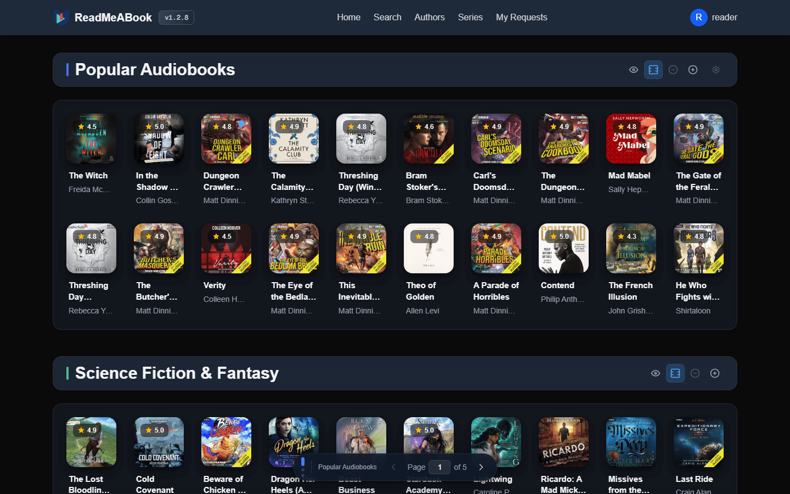
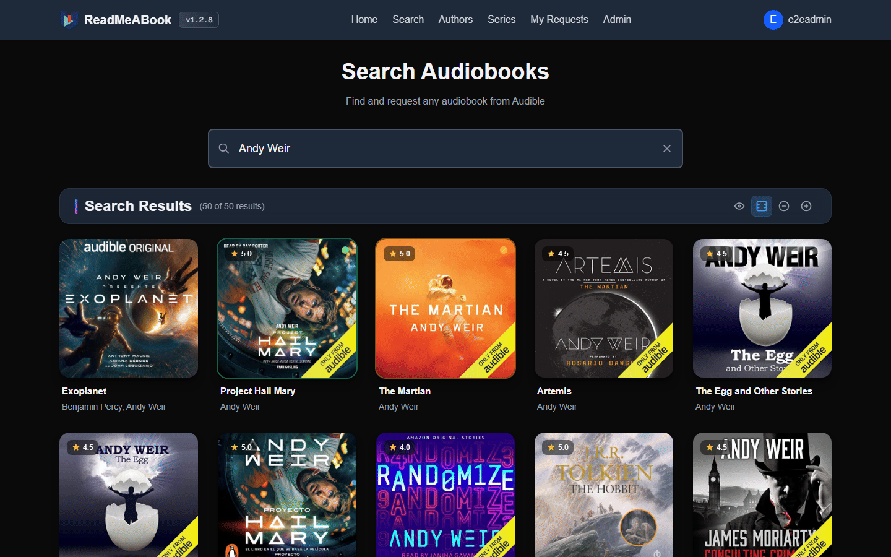
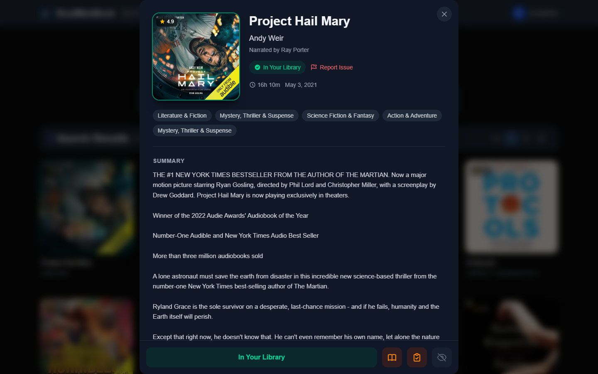
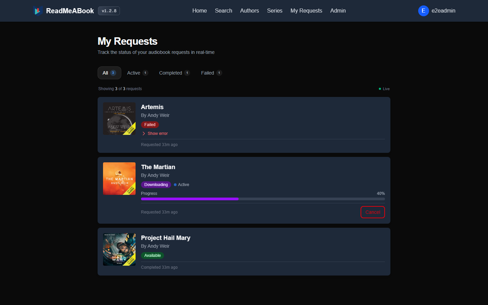
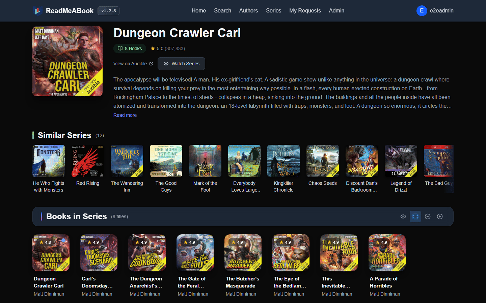
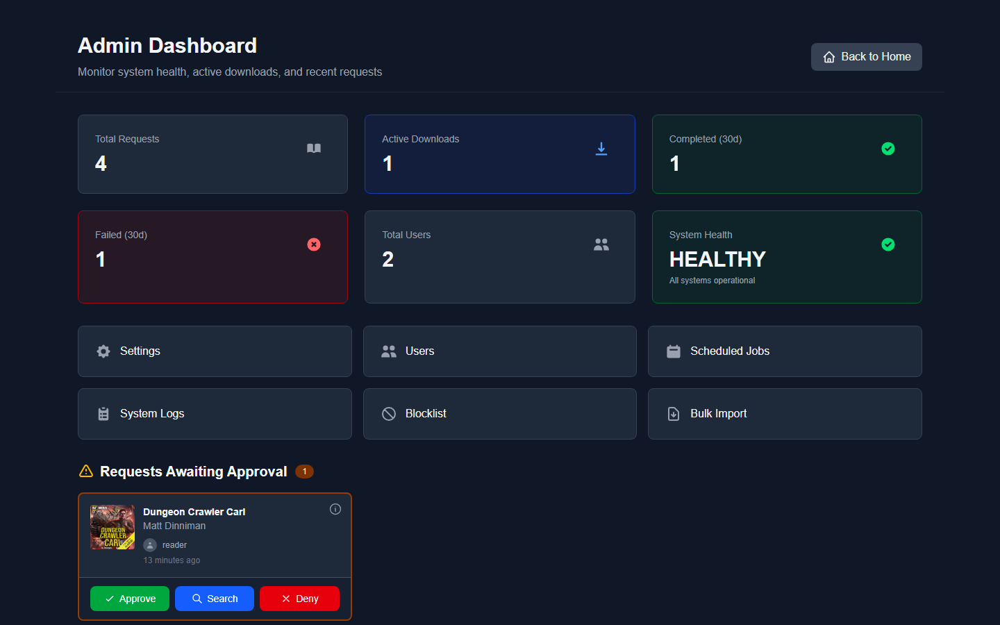
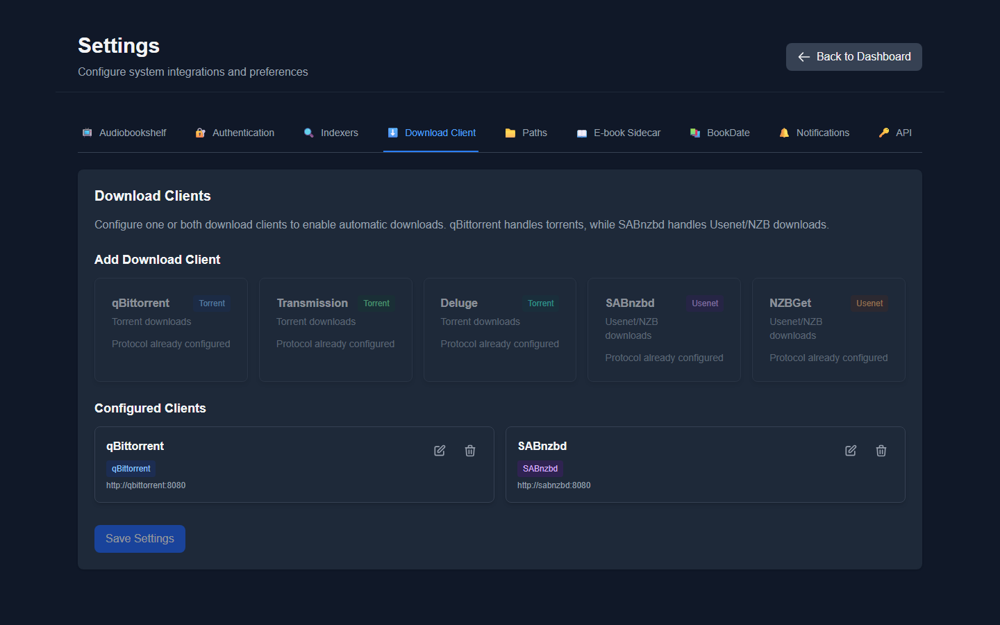

<div align="center">


### Audiobook automation for Plex and Audiobookshelf

<div align="center">

  [](https://ko-fi.com/kikootwo)
  [](https://github.com/sponsors/kikootwo)
  [](https://github.com/kikootwo/readmeabook/actions/workflows/build-unified-image.yml)
  [](https://github.com/kikootwo/readmeabook/actions/workflows/run-tests.yml)
  [](https://github.com/kikootwo/readmeabook/pkgs/container/readmeabook)
  [](https://www.gnu.org/licenses/agpl-3.0)
  [](https://github.com/kikootwo/readmeabook/stargazers)
  [](https://discord.gg/kaw6jKbKts)
</div>

*Radarr/Sonarr + Overseerr for audiobooks, all in one*

[Features](#features) • [Setup](#setup) • [Screenshots](#screenshots) • [Discord](#community)

</div>

---

## What is ReadMeABook?

ReadMeABook (RMAB) is a self-hosted request manager and downloader for audiobooks. Your users find books in an Audible-backed catalog and request them. RMAB searches your indexers through Prowlarr, sends the best release to your torrent or Usenet client, copies the finished files into your Plex or Audiobookshelf library with clean folders and tags, and marks the request available once your server has the book. It runs as a single Docker image with its own PostgreSQL and Redis.

## Features

### Find and request

- **Home page** with Popular, New Releases and Audible category sections. Each user adds, removes and reorders their own sections.
- **Search** by title or author, plus author and series pages.
- **One-click requests.** Books you already have show "In Your Library", so they don't get requested twice.
- **Watch a series or an author** and new releases are requested for you (checked daily).
- **Reading lists:** link a Goodreads shelf (RSS feed) or a Hardcover list from your profile and the books on it are requested for you (synced every 6 hours). Mark a book as ignored to keep lists and watches from requesting it.
- **BookDate:** swipe through personal picks based on your library, ratings and swipe history. Swipe right to request. An admin connects it to OpenAI, Claude, Gemini or any OpenAI-compatible endpoint.
- **Ebooks:** when an ebook source is on, the ebook is fetched after the audiobook, and users can request the ebook for any book already in the library.
- **Report an issue** with a book in the library. Admins can dismiss it or replace the files with another release.

### Downloads and your library

- **Search and ranking:** every Prowlarr indexer you pick, torrent and Usenet, ranked by title and author match, format and seeders, with bonuses from your per-indexer priority and flag rules.
- **Interactive search** to pick the release yourself (a per-user permission).
- **Keeps trying:** books with no good release yet are retried daily and caught from indexer RSS feeds every 15 minutes. Books that aren't released yet are skipped until their release date (on by default).
- **Release blocklist:** a release that fails to download, or still fails to import after retries, is blocked for that request and automatic searches skip it. Admins can review and unblock at `/admin/blocklist`.
- **Seeding rules** per indexer (seeding time and ratio). Finished torrents are removed from the client once the rules are met.
- **Clean imports:** finished downloads are copied into your media folder with a folder template (default `{author}/{title} {asin}`). Download files are removed only after the library copy is verified, and existing library files are never overwritten.
- **File tidy-up:** writes title, author and narrator tags, and renames `.mp4` (and single-file `.m4a`) to `.m4b` so Plex picks them up. Both are on by default and can be turned off.
- **Chapter merging (optional):** multi-file books become a single `.m4b` with chapter markers. The merged file is checked against the source audio before the originals are cleaned up.
- **Ebook sources:** Anna's Archive (optionally through FlareSolverr) and your indexers' ebook categories. Pick EPUB, PDF, MOBI, AZW3 or any, with an optional Kindle fix for EPUB files. Ebooks land in the audiobook's folder.
- **Audible regions:** US, Canada, UK, Australia, India, Germany, Spain, France and Italy. Search and matching work best in the English-language stores.

### Users and admin

- **Plex mode:** users sign in with their Plex account (only accounts with access to your server), and Plex Home profiles count as separate users. The admin account created during setup signs in with a username and password.
- **Audiobookshelf mode:** sign in with OIDC (for example Authentik or Keycloak), with local accounts, or both. OIDC access can be open, limited to a group or an allow list, or need admin approval, and admin rights can come from a group claim. Local accounts can self-register, optionally with admin approval for new accounts.
- **Approvals and permissions:** a global auto-approve setting with per-user overrides, plus per-user interactive search and file download permissions. Admins can also create a personal sign-in link for a user.
- **Admin dashboard:** request and download counts, active downloads with progress, requests awaiting approval, and a searchable list of every request.
- **Safe deletes:** deleting a request removes only the library files that request imported, and follows your seeding rules for the torrent.
- **Imports:** Bulk Import scans a folder, matches each book to Audible and imports the ones you pick. Manual Import adds files for a single book.
- **Scheduled jobs** you can run now, reschedule or turn off, and **system logs** with filters and search.
- **Notifications** through Apprise, Discord, ntfy and Pushover for requests pending approval, approved, grabbed, available, failed and reported issues.
- **API tokens:** personal `rmab_` tokens for scripts (search, create and check requests; admin metrics), with interactive docs at `/api-docs`.

## How it works

1. **Request.** A user requests a book, or a watched series, a synced reading list or a BookDate swipe does it for them. If the request needs approval, it waits for an admin.
2. **Search.** RMAB searches your Prowlarr indexers and ranks what comes back. If nothing good turns up, it keeps watching RSS feeds and retries on a schedule.
3. **Download.** The best release goes to your torrent or Usenet client, and RMAB follows its progress.
4. **Import.** When the download finishes, RMAB copies the files into your media folder, tags them and merges chapters if you turned that on. Torrents keep seeding until your rules are met.
5. **Available.** Plex or Audiobookshelf picks up the new folder (or RMAB asks it to scan, if you enable that). RMAB checks for new library items every 5 minutes, marks the request available and sends your notifications. If an ebook source is on, the ebook follows.

## Setup

### Requirements

- Docker on amd64 or arm64
- Plex Media Server or Audiobookshelf, with an audiobook library
- Prowlarr
- A download client: qBittorrent, Transmission or Deluge for torrents, SABnzbd or NZBGet for Usenet. You can run one of each side by side.

### Quick start

```bash
mkdir readmeabook && cd readmeabook
curl -fsSL https://raw.githubusercontent.com/kikootwo/ReadMeABook/main/docker-compose.yml -o docker-compose.yml
# set your volume paths and PUID/PGID in docker-compose.yml, then:
docker compose up -d
```

Open `http://<your-server>:3030` and follow the setup wizard.

The essentials, if you'd rather write the compose file yourself:

```yaml
services:
  readmeabook:
    image: ghcr.io/kikootwo/readmeabook:latest
    container_name: readmeabook
    restart: unless-stopped
    ports:
      - "3030:3030"
    volumes:
      - ./config:/app/config                # settings and generated secrets, keep this safe
      - ./cache:/app/cache                  # cover thumbnails
      - /path/to/downloads:/downloads       # same container path as your download client
      - /path/to/media:/media               # the wizard's default library folder is /media/audiobooks
      - ./pgdata:/var/lib/postgresql/data
      - ./redis:/var/lib/redis
      # - /path/to/bookdrop:/bookdrop       # optional: extra folder for Manual and Bulk Import
    environment:
      PUID: 1000                            # run `id` on the host
      PGID: 1000
      # PUBLIC_URL: "https://audiobooks.example.com"  # needed for Plex or OIDC sign-in beyond localhost
    healthcheck:
      test: ["CMD", "curl", "-f", "http://localhost:3030/api/health"]
      interval: 30s
      timeout: 10s
      retries: 3
      start_period: 60s
```

**Paths must match.** Your download client and RMAB have to see finished downloads at the same container path (for example both use `/downloads`). If they can't, turn on remote path mapping for that client in RMAB. See the [Volume Mapping Guide](documentation/deployment/volume-mapping.md), or open `/path-helper` in RMAB for a guided check.

**Other settings** (all optional):

- `PUBLIC_URL`: the address people use to reach RMAB, without a trailing slash.
- `UMASK`: for example `002` for group-writable files.
- `DATABASE_URL` / `REDIS_URL`: use an external PostgreSQL or Redis. The built-in one then doesn't start.
- `DISABLE_LOCAL_LOGIN: "true"`: hide the username and password login.
- `ROOTLESS_CONTAINER: "true"`: rootless Podman only.
- `LOG_LEVEL`: defaults to `info`.
- `JWT_SECRET`, `JWT_REFRESH_SECRET`, `CONFIG_ENCRYPTION_KEY` and `POSTGRES_PASSWORD` are generated on first start and saved in `/app/config/.secrets`. Set them only if you want your own values.
- With `PUID`/`PGID` set, config, downloads, media and Redis data belong to that user. PostgreSQL data stays owned by the image's own postgres user, with your group. LXC and WSL2 notes are in the [unified container guide](documentation/deployment/unified.md).

An Unraid template is in [`unraid.xml`](unraid.xml).

### First-run setup

The wizard walks you through it, testing each connection as you go:

1. **Backend:** choose Plex or Audiobookshelf, and your Audible region.
2. **Accounts and library:**
   - Plex: create the admin account, then connect Plex and pick your audiobook library.
   - Audiobookshelf: connect with an API token and pick the library, then choose how people sign in (OIDC, local accounts or both).
3. **Prowlarr:** URL and API key, then choose indexers with a priority, seeding time and RSS setting for each.
4. **Download clients:** add your torrent and/or Usenet client.
5. **Paths:** the download and media folders as RMAB sees them (defaults `/downloads` and `/media/audiobooks`), the folder template, and the tagging, Plex rename and chapter merge options. The media folder has to be the one your Plex or Audiobookshelf library reads from.
6. **BookDate:** optional, can be skipped.
7. **Review and finish.** RMAB runs the first Audible refresh and library scan, then turns on its scheduled jobs.

Everything can be changed later under **Admin > Settings**. With OIDC-only sign-in, the first person to sign in becomes the admin and the first jobs run then.

**Pick your Audible region up front.** Changing it on an existing library can re-request books you already have, and home page category sections have to be picked again.

### Upgrading

```bash
docker pull ghcr.io/kikootwo/readmeabook:latest
docker compose down
docker compose up -d
```

- The database is updated when the container starts. There is nothing to run by hand.
- `latest` is the newest release. To pin one, use a version tag such as `ghcr.io/kikootwo/readmeabook:1.2.8` (`1.2` and `1` also exist).
- Check the [release notes](https://github.com/kikootwo/ReadMeABook/releases) for anything specific to the version you're moving to.
- Keep your `config` folder. Its `.secrets` file holds `CONFIG_ENCRYPTION_KEY`, which encrypts saved passwords and API keys. If it's lost and local sign-in stops working, run `docker exec -it readmeabook npm run rmab:recover` (see [credential recovery](documentation/admin-features/credential-recovery.md)).

## Integrations

| Area | Supported |
|---|---|
| Media server | Plex Media Server, Audiobookshelf |
| Indexers | Prowlarr (torrent and Usenet indexers) |
| Torrent clients | qBittorrent, Transmission, Deluge |
| Usenet clients | SABnzbd, NZBGet |
| Book metadata | Audible (9 regions), Audnexus |
| Ebook sources | Anna's Archive (optional FlareSolverr), Prowlarr ebook categories |
| Reading lists | Goodreads shelves (RSS), Hardcover lists |
| Sign-in | Plex (with Plex Home profiles), OIDC, local accounts |
| Notifications | Apprise, Discord, ntfy, Pushover |
| BookDate | OpenAI, Claude, Google Gemini, OpenAI-compatible endpoints |

## Screenshots









## Community

- **Questions and setup help:** [Discord](https://discord.gg/kaw6jKbKts). Support questions get answered faster there than in issues.
- **Bugs and feature requests:** [GitHub issues](https://github.com/kikootwo/ReadMeABook/issues/new/choose). The bug form asks for your exact version (shown in the app) and deployment type.
- **Security problems:** report them privately, never in a public issue. See [SECURITY.md](SECURITY.md).
- **Contributing:** fixes and features are welcome. Start with [CONTRIBUTING.md](CONTRIBUTING.md) for setup and PR guidelines, and [documentation/TABLEOFCONTENTS.md](documentation/TABLEOFCONTENTS.md) for how the app is laid out.

## Support the project

If ReadMeABook is useful to you, you can support development through [GitHub Sponsors](https://github.com/sponsors/kikootwo) or [Ko-fi](https://ko-fi.com/kikootwo). A star on the repo helps too.

## License

ReadMeABook is licensed under the [GNU AGPL v3](LICENSE).
